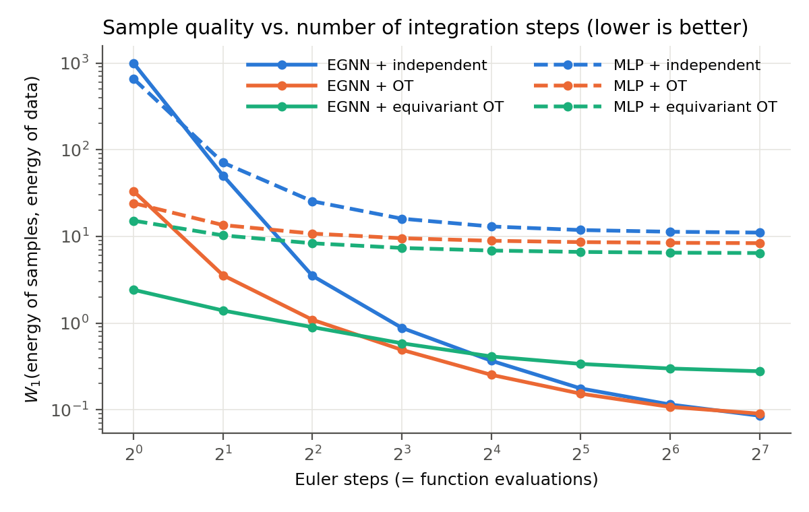

# Symmetry in the model vs. symmetry in the coupling: equivariant flow matching on DW4

A from-scratch reimplementation and ablation of **Equivariant Flow Matching** (Klein, Krämer, Noé, NeurIPS 2023)
on the DW4 many-body system (4 particles in 2D, double-well pair potential).

**Question.** For generative models of particle systems, where should the symmetry go?
* into the **architecture**: an E(n)-equivariant GNN (EGNN) vs. a plain MLP of matched size (~25k parameters);
* into the **coupling** of noise and data in flow matching: independent pairs vs. minibatch OT vs. equivariant OT
  (pairs aligned over permutations and rotations before matching).

All 2 × 3 combinations are trained with the same loss, data and schedule, and compared on sample quality,
integration cost (NFE) and equivariance of the learned flow.

## Results

**Single-seed DW4 ablation:** 100k training configurations, 400 epochs, 10k evaluation samples.

* **Architecture vs. coupling:** at **4 Euler steps**, this ablation **showed a larger benefit from
  equivariant architecture than equivariant OT coupling**: energy W₁ is **25.41 → 3.51** when replacing
  MLP with EGNN under independent coupling, versus **25.41 → 8.32** when adding equivariant OT to MLP.
  Combining EGNN and equivariant OT gives the lowest error at this budget (**0.90**).
* **Adaptive-solver quality:** with adaptive integration, EGNN achieves energy-distribution Wasserstein-1
  errors of **0.070–0.256**, versus **6.364–10.811** for a parameter-matched MLP.
* **Integration budget:** for EGNN, OT reduces energy error at **4 Euler steps from 3.51 to 1.09**
  (equivariant OT: **0.90**). At a target error of **W₁ ≤ 0.5**, OT needs **8 tested Euler steps**,
  versus **16** for independent coupling.
* **Trade-off:** equivariant OT helps at very low step counts but does not improve adaptive-solver
  quality for EGNN (**0.256**, versus **0.070** with independent coupling).

[Results notebook](notebooks/results.ipynb) — executed, with tables and figures; no retraining or dataset download needed.



These observations concern quality at a fixed integration budget, or steps to a fixed quality target;
trajectory straightness was not measured. One seed only; equivariant OT reuses 10 precomputed pair sets,
while the other couplings use fresh noise. Energy and distance marginals do not establish full distributional agreement.

## Repository

```
eqfm/                 library
  egnn.py             E(n)-equivariant GNN vector field (eq. 17-20 of the paper)
  mlp.py              non-equivariant MLP baseline
  flow_matching.py    mean-free prior, conditional flow matching loss, training loop, ODE sampling
  couplings.py        minibatch OT; Hungarian + Kabsch alignment; equivariant OT
  dw4.py              DW4 data loading and energy
  plotting.py
scripts/
  prepare_dw4.py      download the authors' DW4 data (OSF) and convert it to plain arrays
  precompute_eq_ot.py equivariant-OT pairs, computed once before training (as in App. C.4 of the paper)
  run_experiment.py   train + evaluate one configuration
  make_figures.py     figures and summary table
notebooks/results.ipynb executed results walkthrough
tests/                equivariance tests of the EGNN; tests of OT, Kabsch, alignment and equivariant OT
run_all.sh            the full experiment (6 configurations in parallel on CPU)
```

## Reproduce

```bash
pip install -r requirements.txt
pytest                                               # 12 tests
mkdir -p results
nohup bash run_all.sh > results/run_all.log 2>&1 &   # ~2 h on a 20-thread CPU
```

## Implementation notes

* The training set is centered: the prior and the model live on the zero-center-of-mass subspace.
* Equivariant OT costs ~4–10 s per batch of 256 with the per-pair loop, so pairs are precomputed
  (10 pair sets, cycled across epochs). For DW4 the per-pair Hungarian step is replaced by a search over all
  4! permutations before Kabsch rotation (`eq_ot_coupling_bruteforce`), tested against the loop version.
  This sequential alignment is not a joint optimum over permutations and rotations.
* `torchdyn` 1.0.6 `rk4` evaluates time-dependent vector fields at shifted stage times
  (`c[0..2]` instead of `c[1..3]`); `torchdiffeq` is used instead.

## Scope and next steps

DW4 only, one seed. Not done yet: LJ13 / LJ55, likelihoods and importance-sampling ESS (Boltzmann generator
evaluation), several seeds.

## Authorship

The core of the project was implemented by me (Sergei Usanov): the EGNN layer and vector field, the flow matching
loss and prior, the DW4 energy, the training loop, the ODE sampling, minibatch OT, the Hungarian/Kabsch alignment
and equivariant OT. I used Claude (Anthropic) as a coding assistant for code review and debugging and assisting with
routine implementation, testing, data processing, visualization, documentation and this README.

## Reference

L. Klein, A. Krämer, F. Noé. *Equivariant flow matching.* NeurIPS 2023. arXiv:2306.15030.
